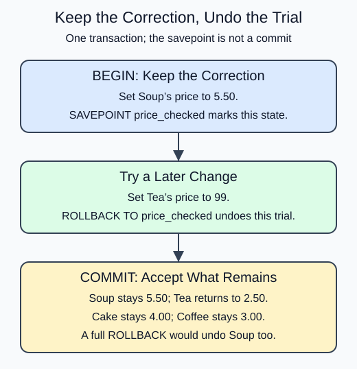

# Undo a later part with SAVEPOINT

A transaction may contain a sound first change and an unwanted later change. SAVEPOINT names a position inside the open transaction. ROLLBACK TO that name discards work after it while preserving earlier work. COMMIT then accepts what remains.

The cafe first corrects Soup to 5.50. It then tries an excessive Tea price, decides against that trial, and rolls back to `price_checked`. The final menu retains the Soup correction and the original Tea price. The savepoint is not a partial commit: none of the transaction has committed until COMMIT.

`RELEASE SAVEPOINT name` removes a savepoint when it is no longer needed; it also does not commit the transaction. A full ROLLBACK would discard both changes. This difference is worth reading carefully in the SQL below.

After a statement error, PostgreSQL can leave a transaction aborted until rollback. The lesson runner stops at the first SQL error, so these demos use deliberate valid trials followed by rollback rather than pretending you can continue past a failing statement in one Run.




```sql run
BEGIN;
UPDATE menu SET price = 5.50 WHERE item_id = 2;
SAVEPOINT price_checked;
UPDATE menu SET price = 99 WHERE item_id = 1;
ROLLBACK TO price_checked;
COMMIT;
SELECT item_id, price FROM menu ORDER BY item_id;
```
