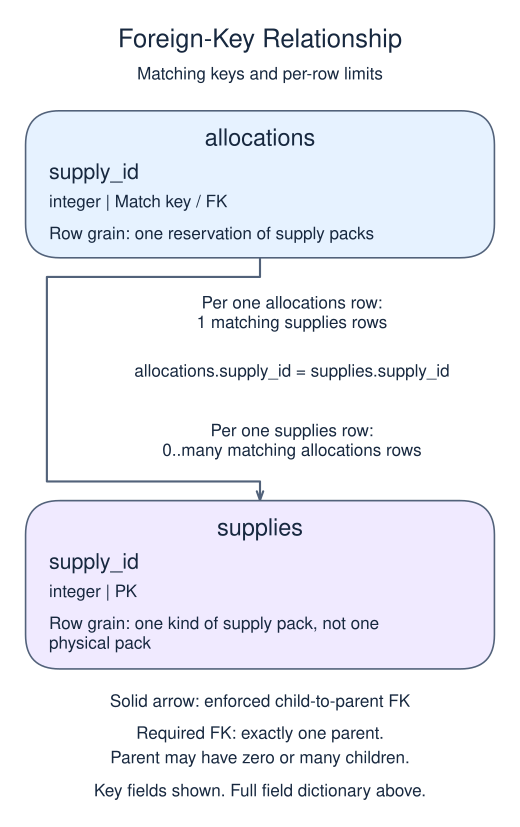

# Project: record an allocation atomically

A repair fair tracks packs still available and packs allocated to a table. The seed supplies two related tables. You will allocate packs, cancel that allocation, then make a revised allocation with an optional trial. These are three stages of the same workflow, not three unrelated fixtures.

## Data model

### Exercise data

These tables are already loaded at the start of this lesson.

#### `allocations`

One row represents one reservation of supply packs.

| Field / SQL type | Meaning | Rules |
| --- | --- | --- |
| `allocation_id` · `integer` | Identifier of the reservation. | Primary key. Required; cannot be `NULL`. |
| `supply_id` · `integer` | Required reference to the reserved supply kind. | Required; cannot be `NULL`. Foreign key to `supplies.supply_id`. |
| `quantity` · `integer` | Whole-number count of packs reserved by this allocation. | Required; cannot be `NULL`. Check: `quantity > 0`. |

#### `supplies`

One row represents one kind of supply pack, not one physical pack.

| Field / SQL type | Meaning | Rules |
| --- | --- | --- |
| `supply_id` · `integer` | Identifier of the supply kind. | Primary key. Required; cannot be `NULL`. |
| `name` · `text` | Name of the supply kind. | Required; cannot be `NULL`. |
| `available` · `integer` | Whole-number count of packs of this kind still unallocated. | Required; cannot be `NULL`. Check: `available >= 0`. |

Stock counts and allocation quantities require coordinated writes; the constraints do not automatically reconcile them.

### Relationship map



`allocations.supply_id` matches `supplies.supply_id`. One `supplies` row can have zero or many matching `allocations` rows; each `allocations` row must reference exactly one existing parent. This is a declared foreign key.

Joining child detail repeats the parent fields once per matching child. An inner join omits unmatched rows; a left join keeps unmatched rows from its left input with NULLs for the missing side. Those result NULLs are separate from missing values stored in a real row.

### State for this lesson

The starting `allocations` table is empty. `supplies` starts with 10 Repair packs and 6 Paint packs; the relationship rules are independent of those sample counts.

One `supplies` row is one kind of pack, not one physical pack. `available` counts unallocated packs of that kind. One `allocations` row is one reservation, identified by `allocation_id`; its required `supply_id` references the kind reserved and `quantity` counts packs. One supply kind can have many allocations. The schema prevents orphan allocations and negative available stock, but it does not automatically keep the two quantities in agreement: your paired writes must do that.

Stage 1 has 10 Repair packs and 6 Paint packs, with no allocation rows. Reserving three Repair packs means subtracting three from available stock and recording allocation 100. Put both changes inside one transaction so they are accepted as a unit.

UPDATE, INSERT, BEGIN, COMMIT, and LEFT JOIN have all been taught. The final report includes supplies with no allocation so you can see untouched stock too. This exercise has fixed data and one session; it does not simulate concurrent allocation or guarantee a production-safe inventory workflow. A real application must also handle competing requests and verify affected rows.

## Restored starting state

This read-only setup runs before your SQL. Add only the new stage in `script.sql`.

```sql
CREATE TABLE supplies (
  supply_id integer PRIMARY KEY,
  name text NOT NULL,
  available integer NOT NULL CHECK (available >= 0)
);
CREATE TABLE allocations (
  allocation_id integer PRIMARY KEY,
  supply_id integer NOT NULL REFERENCES supplies(supply_id),
  quantity integer NOT NULL CHECK (quantity > 0)
);
INSERT INTO supplies VALUES (1,'Repair packs',10),(2,'Paint packs',6);
```

Edit `script.sql`, use Run to inspect the result, then Submit.

## Your Task

1. Within one committed transaction, subtract 3 from supply_id 1 available and insert allocation (100,1,3). Return supply_id, available, allocation_id, quantity using a LEFT JOIN, ordered by supply_id then allocation_id.

## Result to aim for

| supply_id | available | allocation_id | quantity |
| --- | --- | --- | --- |
| 1 | 7 | 100 | 3 |
| 2 | 6 | NULL | NULL |
