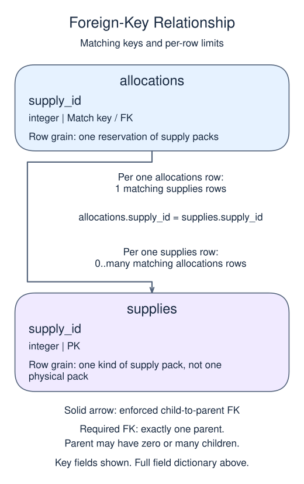

# Project: cancel the recorded allocation

The seed restores stage 1 exactly: Repair packs has 7 available and allocation 100 holds 3. Paint packs is still at 6. The organizer has cancelled that allocation.

## Data model

### Exercise data

These tables are already loaded at the start of this lesson.

#### `allocations`

One row represents one reservation of supply packs.

| Field / SQL type | Meaning | Rules |
| --- | --- | --- |
| `allocation_id` · `integer` | Identifier of the reservation. | Primary key. Required; cannot be `NULL`. |
| `supply_id` · `integer` | Required reference to the reserved supply kind. | Required; cannot be `NULL`. Foreign key to `supplies.supply_id`. |
| `quantity` · `integer` | Whole-number count of packs reserved by this allocation. | Required; cannot be `NULL`. Check: `quantity > 0`. |

#### `supplies`

One row represents one kind of supply pack, not one physical pack.

| Field / SQL type | Meaning | Rules |
| --- | --- | --- |
| `supply_id` · `integer` | Identifier of the supply kind. | Primary key. Required; cannot be `NULL`. |
| `name` · `text` | Name of the supply kind. | Required; cannot be `NULL`. |
| `available` · `integer` | Whole-number count of packs of this kind still unallocated. | Required; cannot be `NULL`. Check: `available >= 0`. |

Stock counts and allocation quantities require coordinated writes; the constraints do not automatically reconcile them.

### Relationship map



`allocations.supply_id` matches `supplies.supply_id`. One `supplies` row can have zero or many matching `allocations` rows; each `allocations` row must reference exactly one existing parent. This is a declared foreign key.

Joining child detail repeats the parent fields once per matching child. An inner join omits unmatched rows; a left join keeps unmatched rows from its left input with NULLs for the missing side. Those result NULLs are separate from missing values stored in a real row.

### State for this lesson

The seed restores the committed allocation: Repair packs has 7 available, allocation 100 reserves 3, and Paint packs has 6 available. These are starting values, not schema constraints.

Cancellation requires two related changes: put the three packs back and delete the allocation record. Deleting only the record would lose track of three packs; restoring only stock would leave a misleading reservation. Use one transaction again.

You do not rerun stage 1 in the editor. It is already part of this stage's seed. The final report should keep both supplies and show NULL allocation fields for each, demonstrating that cancellation did not remove the supplies themselves. In a real system you might retain an audit record rather than deleting it; this project's chosen model uses deletion to practice a reversible allocation.

## Restored starting state

This read-only setup runs before your SQL. Add only the new stage in `script.sql`.

```sql
CREATE TABLE supplies (
  supply_id integer PRIMARY KEY,
  name text NOT NULL,
  available integer NOT NULL CHECK (available >= 0)
);
CREATE TABLE allocations (
  allocation_id integer PRIMARY KEY,
  supply_id integer NOT NULL REFERENCES supplies(supply_id),
  quantity integer NOT NULL CHECK (quantity > 0)
);
INSERT INTO supplies VALUES (1,'Repair packs',10),(2,'Paint packs',6);
BEGIN;
UPDATE supplies SET available = available - 3 WHERE supply_id = 1;
INSERT INTO allocations VALUES (100,1,3);
COMMIT;
```

Edit `script.sql`, use Run to inspect the result, then Submit.

## Your Task

1. Within one committed transaction, restore 3 to supply_id 1 available and delete allocation_id 100. Return supply_id, available, allocation_id, quantity using the same LEFT JOIN and ordering as stage 1.

## Result to aim for

| supply_id | available | allocation_id | quantity |
| --- | --- | --- | --- |
| 1 | 10 | NULL | NULL |
| 2 | 6 | NULL | NULL |
