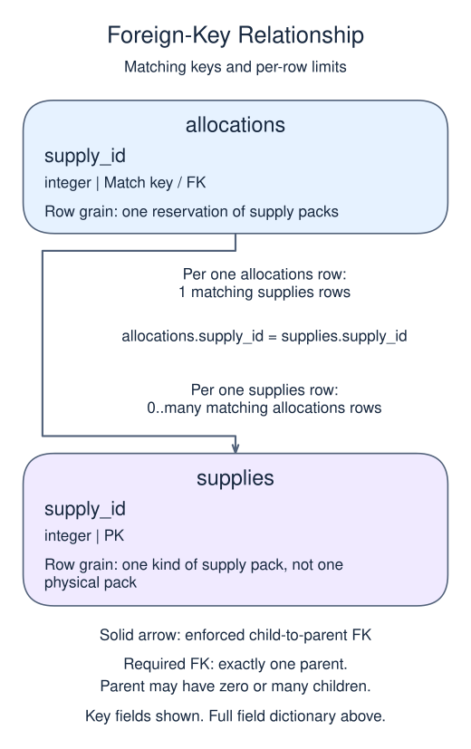

# Project: keep the revised plan, reject an add-on

The seed restores the completed cancellation from stage 2. Both original stock counts are back and allocations is empty. The revised plan reserves two Paint packs. Someone also suggests adding a Repair pack, but that suggestion is withdrawn before commit.

## Data model

### Exercise data

These tables are already loaded at the start of this lesson.

#### `allocations`

One row represents one reservation of supply packs.

| Field / SQL type | Meaning | Rules |
| --- | --- | --- |
| `allocation_id` · `integer` | Identifier of the reservation. | Primary key. Required; cannot be `NULL`. |
| `supply_id` · `integer` | Required reference to the reserved supply kind. | Required; cannot be `NULL`. Foreign key to `supplies.supply_id`. |
| `quantity` · `integer` | Whole-number count of packs reserved by this allocation. | Required; cannot be `NULL`. Check: `quantity > 0`. |

#### `supplies`

One row represents one kind of supply pack, not one physical pack.

| Field / SQL type | Meaning | Rules |
| --- | --- | --- |
| `supply_id` · `integer` | Identifier of the supply kind. | Primary key. Required; cannot be `NULL`. |
| `name` · `text` | Name of the supply kind. | Required; cannot be `NULL`. |
| `available` · `integer` | Whole-number count of packs of this kind still unallocated. | Required; cannot be `NULL`. Check: `available >= 0`. |

Stock counts and allocation quantities require coordinated writes; the constraints do not automatically reconcile them.

### Relationship map



`allocations.supply_id` matches `supplies.supply_id`. One `supplies` row can have zero or many matching `allocations` rows; each `allocations` row must reference exactly one existing parent. This is a declared foreign key.

Joining child detail repeats the parent fields once per matching child. An inner join omits unmatched rows; a left join keeps unmatched rows from its left input with NULLs for the missing side. Those result NULLs are separate from missing values stored in a real row.

### State for this lesson

The seed restores the completed cancellation: available stock is 10 Repair packs and 6 Paint packs, and `allocations` is empty. The prior SQL in the seed reconstructs this state before the new stage.

Record the wanted allocation first, then create a savepoint. Try the optional allocation after it, roll back only that later part, and commit the remaining work. The final report must retain allocation 101 for Paint packs and no allocation for Repair packs.

All the syntax comes from earlier lessons. The challenge is choosing the boundary: the savepoint belongs after the two statements that make the valid allocation, not between them. Otherwise rolling back could keep a stock deduction without its matching allocation.

Submit compares the final state and cannot inspect the transaction history. Read your sequence once more to confirm that the optional pair of writes really sits after the savepoint. You have now practiced an allocation, its cancellation, and a revised plan without changing the underlying schema.

## Restored starting state

This read-only setup runs before your SQL. Add only the new stage in `script.sql`.

```sql
CREATE TABLE supplies (
  supply_id integer PRIMARY KEY,
  name text NOT NULL,
  available integer NOT NULL CHECK (available >= 0)
);
CREATE TABLE allocations (
  allocation_id integer PRIMARY KEY,
  supply_id integer NOT NULL REFERENCES supplies(supply_id),
  quantity integer NOT NULL CHECK (quantity > 0)
);
INSERT INTO supplies VALUES (1,'Repair packs',10),(2,'Paint packs',6);
BEGIN;
UPDATE supplies SET available = available - 3 WHERE supply_id = 1;
INSERT INTO allocations VALUES (100,1,3);
COMMIT;
BEGIN;
UPDATE supplies SET available = available + 3 WHERE supply_id = 1;
DELETE FROM allocations WHERE allocation_id = 100;
COMMIT;
```

Edit `script.sql`, use Run to inspect the result, then Submit.

## Your Task

1. In one transaction, subtract 2 from supply_id 2 and insert (101,2,2). Savepoint core_allocation; then subtract 1 from supply_id 1 and insert (102,1,1). Roll back to the savepoint and commit. Return supply_id, available, allocation_id, quantity with the same LEFT JOIN and ordering.

## Result to aim for

| supply_id | available | allocation_id | quantity |
| --- | --- | --- | --- |
| 1 | 10 | NULL | NULL |
| 2 | 4 | 101 | 2 |
