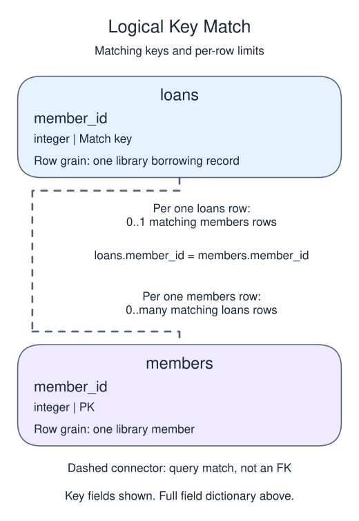

# Ask whether a related row exists

A library wants each member who has at least one loan, regardless of how many. EXISTS tests whether its subquery returns any rows. It does not attach those rows to the output, so members do not multiply when they have several loans.

## Data model

### Example data

These tables are already loaded at the start of this lesson.

#### `loans`

One row represents one library borrowing record.

| Field / SQL type | Meaning | Rules |
| --- | --- | --- |
| `loan_id` · `integer` | Identifier of the loan. | Primary key. Required; cannot be `NULL`. |
| `member_id` · `integer` | Member identifier used to match the borrower in `members`. | Nullable; `NULL` means the identifier is unrecorded. |
| `title` · `text` | Title recorded for the borrowed book; not a separate book identifier. | Nullable; `NULL` means no title value is recorded. |

#### `members`

One row represents one library member.

| Field / SQL type | Meaning | Rules |
| --- | --- | --- |
| `member_id` · `integer` | Identifier of the member. | Primary key. Required; cannot be `NULL`. |
| `name` · `text` | Member display name; different members may share a name. | Nullable; `NULL` means no name value is recorded. |

### Relationship map



`loans.member_id` matches `members.member_id`. One `members` row can have zero or many matching `loans` rows; each `loans` row can match zero or one parent because the parent key is unique. This is a logical match, not a declared foreign key; a NULL or unmatched child identifier is allowed.

`EXISTS` tests for a matching child without copying child rows into the output, so multiple matches do not multiply a parent row.

The subquery refers to `m.member_id` from the outer query. That makes it correlated: for the member being considered, it asks whether a matching loan exists. `SELECT 1` is conventional here because the selected value is irrelevant; only the presence of a row matters.

Run the example and expect Asha and Bo once each. NOT EXISTS answers the opposite question and would return Cleo. Unlike a careless NOT IN query, a NULL somewhere in the inner key column does not poison the whole absence test; the equality simply fails to find a match for that row.

The correlation predicate is essential. Without `l.member_id = m.member_id`, one loan anywhere would make EXISTS true for every member. This is a logic mistake, not a syntax error, so test both a member with loans and one without.

```sql run
SELECT m.name
FROM members AS m
WHERE EXISTS (
  SELECT 1 FROM loans AS l
  WHERE l.member_id = m.member_id
)
ORDER BY m.member_id;
```
